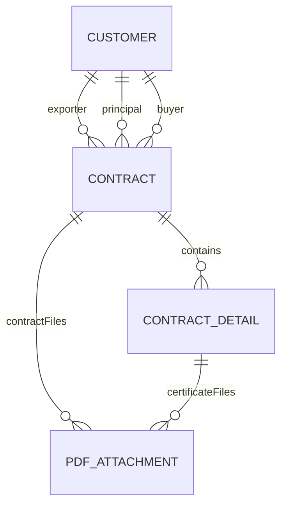

# HAK Parent Child Contract Schema v3

Áp dụng quy chuẩn `HAK_AI_SKILLS/skills/hak-parent-child-data-model/SKILL.md` và mẫu master–detail của `HAK-Enterprise-Design-System/docs/DESIGN_SYSTEM_V10_4.md`. Đây là thiết kế dành cho app offline hiện tại, không nhập logic nghiệp vụ của app khác.

## ERD

PDF dùng chung có thể được nhiều dòng tham chiếu; sơ đồ chỉ biểu diễn đường truy cập. PDF có ID SHA-256, liên kết là mảng ID; không xóa vật lý khi bỏ tham chiếu.

## Data dictionary và schema

Lưu một snapshot `{v:3, customers:[], contracts:[]}` ở `hak.catalog.v1` (localStorage + IndexedDB.kv).

| Thực thể | Trường | Quy tắc |
|---|---|---|
| CONTRACT | id | PK ổn định, tạo ở ContractModel.parent |
| CONTRACT | no, type, date | Khóa nghiệp vụ no+type không trùng giữa hợp đồng đang dùng; ngày ISO |
| CONTRACT | exporterId, principalId, buyerId | FK đến Customer.id, có thể trống khi chưa có thông tin |
| CONTRACT | currency, priceUsd, dryFactory, note | Thông tin chung, đơn giá mặc định và hệ số dùng lại |
| CONTRACT | contractFiles | ID các PDF hợp đồng; giữ nguyên byte gốc |
| CONTRACT | revision, deletedAt | Kiểm soát sửa đồng thời và lưu trữ mềm |
| CONTRACT_DETAIL | id, contractId | PK riêng, FK không được trỏ sang cha khác |
| CONTRACT_DETAIL | product, tkhq, ship | Hàng hóa, TKHQ, tàu/chuyến của dòng |
| CONTRACT_DETAIL | qty | Khối lượng hợp đồng phân bổ cho dòng, BDMT; không âm hoặc null |
| CONTRACT_DETAIL | priceUsd | Đơn giá dòng, null = dùng mặc định cha |
| CONTRACT_DETAIL | certNo, certDate, mt, bdmt, moisture | Một bộ số liệu thực hiện/chứng thư cho dòng; MT/BDMT tách riêng |
| CONTRACT_DETAIL | deliverId, whId, fromDate, toDate, filterTrips | Bên giao/kho/khoảng ngày dùng lập chứng từ |
| CONTRACT_DETAIL | certificateFiles | Mảng ID PDF chứng thư |
| CONTRACT_DETAIL | sourcePdfId, sourcePage, sourceEvidence | Dấu vết đề xuất OCR được người dùng chọn |
| CONTRACT_DETAIL | revision, deletedAt, legacyAlias | Phiên bản, ngừng dùng mềm, liên kết bản ghi cũ |

Các dòng cùng hợp đồng có thể chung TKHQ nhưng khác hàng hóa. TKHQ trùng giữa các hợp đồng đang dùng tiếp tục bị chặn theo quy tắc cũ. ID chi tiết không được trùng toàn danh mục. Tổng qty, mt, bdmt tính từ những dòng đang dùng; không quy đổi các đơn vị để cộng lẫn nhau. Độ khô thực tế giữ công thức bdmt/mt.

## API contract

- `ContractModel.migrate(catalog)` trả snapshot mới, không sửa đầu vào.
- `ContractModel.parent(value)`, `child(parentId,value)` tạo ID ở lớp dữ liệu.
- `ContractModel.upsert(catalog,value,expectedRevision)` kiểm tra toàn bộ cha/con; trả snapshot mới hoặc ném lỗi, đầu vào giữ nguyên.
- `Catalog.upsertContract(value,expectedRevision)` chuẩn bị snapshot trong bộ nhớ, trả `{rec}` hoặc `{error}`. Caller phải `await Catalog.persist()` / `Catalog.save()` trước khi báo thành công.
- `Catalog.parents(type)` lấy cha đang dùng; `Catalog.contracts(type)` là projection từng dòng con cho các màn chứng từ/báo cáo cũ.
- `Catalog.contract(detailId)` lấy đúng dòng; `{history:true}` cho báo cáo lịch sử, kể cả dòng đã ngừng dùng.
- ID cha cũ được ánh xạ về dòng legacy của chính nó; cha mới có nhiều con không tự chọn một dòng mặc định.
- Nhập lặp có sourcePdfId+sourceEvidence không thêm lại đề xuất cùng một dòng. Nhập gói cấu hình hợp nhất theo PK cha/con, giữ các dòng và PDF cục bộ không có trong gói.

## Transaction, migration và quyền

Các thay đổi cha/con được chuẩn bị trong một bản sao. UI khôi phục snapshot bộ nhớ trước thao tác khi lỗi; các tham chiếu PDF không công bố vào danh mục trước khi ghi xong.

Lần đầu lưu v2→v3: ghi bản gốc ở `hak.catalog.v1.before-parent-child`, đọc lại và so sánh toàn bộ JSON. Không đổi dữ liệu gốc nếu bước này thất bại. Với IndexedDB, cập nhật danh mục chạy trong một transaction kv có compare-and-swap snapshot cũ; abort nếu cửa sổ khác đã ghi. localStorage là cache của snapshot đã commit; bản kv được đánh dấu authoritative để boot phục hồi cache cũ khi hết dung lượng. Nếu IndexedDB không dùng được, lưu nguyên một JSON sau khi xác minh backup localStorage; khả năng đồng thời của fallback yếu hơn transaction IndexedDB.

| Thao tác | Hành vi và quyền |
|---|---|
| Xem/tìm hợp đồng và con | Giữ phạm vi công ty từ Auth.scopeIds và Catalog.relatedTo |
| Tạo/sửa | Giữ quyền vào màn Danh mục hiện có; kiểm tra FK, dữ liệu và revision |
| Xóa hợp đồng | Lưu trữ mềm cả cha; con và PDF còn giữ; có khôi phục |
| Xóa dòng | Ngừng dùng mềm; bỏ khỏi tổng/ô chọn mới; có khôi phục |
| Xóa khách hàng | RESTRICT khi còn được cha/con, kể cả lịch sử, tham chiếu |
| Báo cáo lịch sử | Tìm đúng ID trước; không gắn sang dòng khác chỉ vì cùng tên tàu |
| Nhập gói | Kiểm tra snapshot hợp nhất trước khi áp dụng gói; FK sai bị từ chối |

Ứng dụng offline giữ cơ chế phân quyền vốn có; đây không phải bổ sung một máy chủ phân quyền hay đồng bộ nhiều máy.

## Test cases và rủi ro

Thực thi các test trong `tests/contract-model.test.cjs`, `tests/catalog-parent-child.test.cjs`, `tests/report.test.cjs`, `tests/documents.test.cjs`: cha không con/một con/nhiều con; migration giữ số liệu và PDF; khóa trùng/FK sai; cùng TKHQ nhiều mặt hàng; số âm; nhập Excel lặp; nhập cấu hình lặp; đối chiếu bên bằng MST; lỗi backup/ghi transaction; stale revision/cửa sổ khác; khôi phục cache khi hết dung lượng; ngừng dùng/tra cứu lịch sử; điền form và chụp dữ liệu lưu trữ của đúng dòng con.

Nguồn OCR thực tế chỉ dùng trong work ngoài repo. Các test trong repo là dữ liệu giả. Kiểm tra UI trực tiếp và dàn trang Word/PDF còn chưa xác nhận do giới hạn công cụ đã ghi trong hướng dẫn 2.9.0. Revision và dấu vết PDF không thay thế hệ thống lưu mọi phiên bản kiểm toán bất biến. Một dòng hiện giữ một bộ số liệu thực hiện; cần tách các đợt thành các dòng có khối lượng phân bổ tương ứng, không nhân lại toàn bộ KL hợp đồng trên mỗi dòng.
